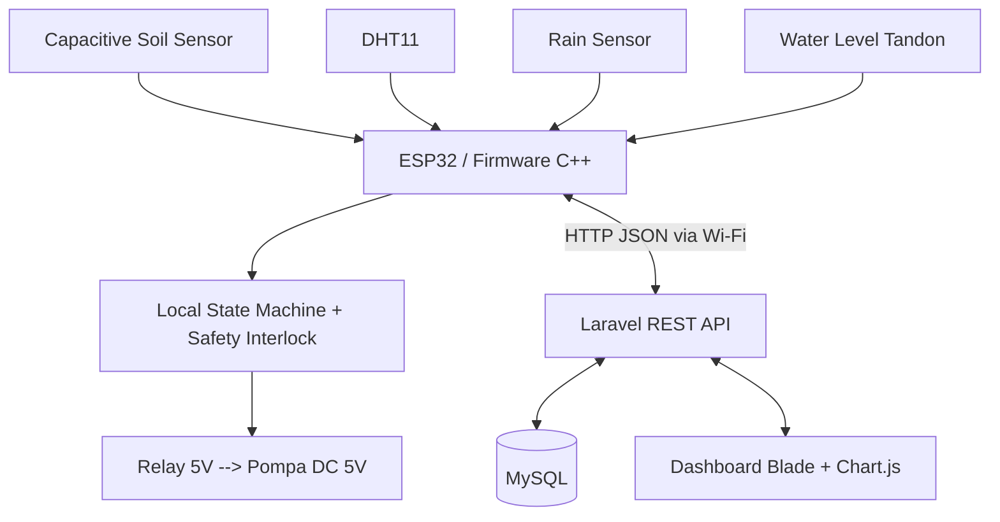

# PROJECT CONTEXT — Adaptive Smart Irrigation System

> **Dokumen acuan bersama untuk 6 anggota tim dan AI assistant masing-masing.**  
> Versi: 1.0 — 2 November 2026  
> Status: **Rancangan disepakati; implementasi belum dimulai/hasil uji belum tersedia.**  
> Bahasa kerja: Indonesia.  
> Program: Tugas Besar IoT, D3 Teknik Informatika, Politeknik.

---

## 0. INSTRUKSI UNTUK AI ASSISTANT SETIAP ANGGOTA (BACA TERLEBIH DAHULU)

Kamu adalah asisten teknis yang membantu salah satu dari enam anggota mengembangkan proyek **Adaptive Smart Irrigation System**. Baca keseluruhan dokumen ini sebagai *single shared project context* sebelum mengusulkan arsitektur, menulis kode, melakukan debugging, atau membuat dokumentasi.

**Aturan kerja:**
1. Gunakan keputusan pada dokumen ini sebagai **baseline**. Jangan mengganti stack Laravel + MySQL, ESP32, skema arsitektur, nama field API, atau pembagian tanggung jawab secara sepihak.
2. Bedakan **FAKTA PAPER**, **KEPUTUSAN PROYEK**, **USULAN/ASUMSI**, dan **BELUM DIVERIFIKASI**. Jangan menyajikan usulan sebagai fakta dari artikel ilmiah.
3. Jika perubahan diperlukan, sebutkan alasan, dampak pada anggota lain, biaya, risiko, dan berikan usulan pembaruan dokumen ini. Mintalah sinkronisasi tim jika menyangkut kontrak lintas subsistem.
4. Utamakan prototipe yang **aman, murah, mudah didemokan**, dan benar-benar bisa selesai **6 minggu** oleh tim dengan kemampuan dasar–menengah.
5. Jangan menggunakan 220V secara langsung pada rangkaian prototipe; gunakan komponen DC bertegangan rendah. Jangan menghubungkan pompa langsung ke pin ESP32.
6. Jangan membuat klaim hasil eksperimen (akurasi, respons, penghematan air) sebelum ada data pengukuran nyata.
7. Jangan memasukkan password Wi-Fi, token API, kredensial database, atau rahasia lain ke GitHub.
8. Saat membuat kode, ikuti kontrak pada dokumen ini; jika ada spesifikasi yang belum final, tandai sebagai **TO BE DECIDED (TBD)**.
9. Semua anggota wajib menghasilkan kontribusi teknis nyata, pengujian, dan dokumentasi sesuai modulnya.
10. Jika pengguna bertanya tentang pekerjaan spesifik anggota, fokus pada modul tersebut tetapi selalu perhatikan kompatibilitas keseluruhan sistem.

**Template permintaan ke AI masing-masing anggota:**

```text
Gunakan PROJECT_CONTEXT.md terlampir sebagai sumber keputusan proyek kami.
Saya adalah Anggota [1-6], bertanggung jawab atas [modul].
Bantu saya mengerjakan [tugas spesifik] dengan tetap mengikuti arsitektur,
kontrak API, aturan keselamatan, anggaran, dan milestone dalam dokumen.
Jangan mengubah keputusan lintas-modul tanpa menjelaskan dampaknya.
Pisahkan asumsi baru dari spesifikasi yang sudah disepakati.
```

---

## 1. IDENTITAS DAN TUJUAN PROYEK

**Judul kerja (Indonesia):** Sistem Irigasi Cerdas Adaptif Berbasis ESP32 dengan Proteksi Tandon dan Dashboard Laravel.  
**Judul kerja (Inggris):** Adaptive Smart Irrigation and Reservoir Protection System Based on ESP32 with Laravel Dashboard.

**Tujuan:** merancang prototipe yang mengukur kelembapan tanah dan kondisi lingkungan, mengendalikan pompa DC secara otomatis, mencegah pengoperasian ketika tandon kosong atau terjadi kegagalan sensor, serta menampilkan data dan riwayat pengambilan keputusan melalui dashboard web.

**Batasan:**
- Tim: **6 orang**.
- Waktu pengerjaan: **6 minggu**.
- Kemampuan: dasar–menengah (Arduino IDE/C++, PHP, web, basis data).
- Stack dipilih: **ESP32 + C++ + Laravel + MySQL + Blade/Tailwind + Chart.js**.
- Budget total maksimal sekitar **Rp420.000**; target lebih rendah karena ESP32 dan beberapa komponen pendukung sudah tersedia.
- Demo langsung dalam **5 menit**.
- Hindari listrik AC 220V langsung, custom PCB, LoRa, Raspberry Pi, kamera/AI berat, server/gateway khusus.
- GitHub digunakan untuk source code, dokumentasi, pengujian, dan koordinasi.

### 1.1 Artikel penelitian acuan

- **Judul:** *Analysis and experimental implementation of affordable smart irrigation system using IoT to reduce agricultural costs and minimize water usage*.
- **Jurnal:** *Applied Water Science*, Springer.
- **Tahun:** 2026 (berdasarkan identifikasi dalam pembahasan sebelumnya; cek lagi halaman penerbit sebelum finalisasi sitasi).
- **DOI:** `10.1007/s13201-025-02727-4`.
- **Link resmi:** https://doi.org/10.1007/s13201-025-02727-4
- **Status akses:** disebut open access pada diskusi sebelumnya; **verifikasi ulang pada halaman penerbit untuk laporan akhir**.
- **Indeks Scopus / quartile dan tahun SCImago:** **BELUM DIVERIFIKASI dalam dokumen ini**; jangan menuliskan Q tertentu tanpa bukti yang dapat dirujuk.
- **Repository GitHub resmi paper:** **TIDAK ADA DI PAPER** menurut pemeriksaan sebelumnya; jangan mengarang URL repositori.

**Catatan penting dokumen sumber:** PDF yang pernah dilampirkan dalam percakapan ternyata berjudul *Design of flood warning prototype using ESP32 module-based ultrasonic sensors* (IJRES, 2025), **BUKAN** artikel irigasi yang dijadikan dasar. Jangan gunakan PDF deteksi banjir tersebut untuk menyimpulkan metode, komponen, ataupun hasil eksperimen paper irigasi. Gunakan tautan penerbit DOI di atas.

### 1.2 Informasi dari paper yang dibahas sebelumnya — perlu disitasi dari teks asli

Informasi berikut dicatat dari pembacaan artikel penerbit pada diskusi sebelumnya, tetapi saat menulis laporan **cek kembali bagian dan angka persisnya** pada teks resmi:

- Sistem menggunakan **ESP32, sensor kelembapan tanah kapasitif, DHT11, platform Blynk, relay, dan pompa**.
- Sensor intensitas cahaya **TSL2561** juga disebut pada uraian komponen paper; komponen ini **tidak wajib** untuk prototipe tim.
- Logika paper disebut menyalakan pompa saat kelembapan tanah **di bawah 20%**, dan mematikan saat **di atas 80%**; jangan memperlakukan batas ini sebagai nilai universal untuk setiap tanah/sensor.
- Suhu **di atas 45°C** disebut sebagai kondisi notifikasi.
- Pengujian paper dilaporkan selama **30 hari**, pada tanaman tomat dan tanah loam; penghematan air dalam diskusi disebut **25–35%** atau sekitar **33,3%** terhadap irigasi terjadwal.
- Keterbatasan yang dibahas: sensor drift, perbedaan kalibrasi tanah, ketidakstabilan Wi-Fi, dan peluang peningkatan logika adaptif.

**Prinsip integritas ilmiah:** Semua hasil tersebut milik **penulis jurnal**, bukan hasil eksperimen tim. Jika detail tidak ditemukan setelah membuka artikel asli, tulis **TIDAK ADA DI PAPER**; jika belum diperiksa, tulis **BELUM DIVERIFIKASI**.

---

## 2. FITUR PROYEK: MVP VS PENGEMBANGAN

### 2.1 MVP — WAJIB (target selesai akhir minggu 4)

1. ESP32 membaca **soil moisture kapasitif**, **DHT11**, dan **level tandon**.
2. Kalibrasi sensor tanah dengan titik kering/basah yang didefinisikan jelas; simpan ADC mentah dan persentase hasil kalibrasi.
3. Pompa DC 5V menyala dan mati otomatis berdasar batas bawah/atas yang dapat dikonfigurasi (**histeresis**).
4. **Safety interlock:** pompa OFF jika tandon kosong, pembacaan sensor kritis gagal, atau durasi aktif melebihi batas maksimum.
5. ESP32 mengirim telemetry JSON ke REST API Laravel via Wi-Fi.
6. Laravel menyimpan telemetry dan event pompa ke MySQL.
7. Dashboard menampilkan data sensor terbaru, status pompa, serta histori grafik.
8. Dashboard menyediakan mode **AUTO / MANUAL**, tetapi perintah manual **tidak boleh** melewati safety interlock lokal.
9. Ada log alasan perubahan status pompa dan hasil pengujian dengan bukti.

### 2.2 Pengembangan setelah MVP stabil (minggu 5)

1. **Adaptive irrigation:** menggabungkan soil moisture, suhu/RH, dan sensor hujan untuk menunda/menyesuaikan irigasi dengan aturan yang jelas dan diuji.
2. **Reservoir protection lebih lengkap:** log alasan `TANK_EMPTY`, `PUMP_TIMEOUT`, atau `SENSOR_ERROR`.
3. **Audit dashboard:** histori keputusan dan alasan ON/OFF, bukan hanya nilai sensor.
4. **Notifikasi dalam dashboard** untuk tandon kosong, sensor gagal, koneksi putus, dan status fault.

**Bukan MVP / jangan dikerjakan dulu:** machine learning, OTA, LoRa, cloud komersial berbayar, aplikasi Android native, deep sleep, flow sensor, atau sistem prediksi cuaca eksternal.

---

## 3. ARSITEKTUR DAN PRINSIP TEKNIS



**Kebijakan wajib:** keputusan ON/OFF dan keselamatan pompa berada **di ESP32**. Laravel berfungsi untuk monitoring, penyimpanan data, konfigurasi, serta mengirim permintaan, **bukan** sebagai satu-satunya pengendali pompa. Sistem lokal harus tetap aman ketika Wi-Fi/server gagal.

### 3.1 Pin mapping awal yang dipilih tim (BUKAN pin original paper)

| Komponen | Pin ESP32 | Fungsi / catatan |
|---|---|---|
| Capacitive soil moisture AO | GPIO34 | ADC1, sesuai ketika Wi-Fi aktif |
| Water level analog S | GPIO35 | ADC1, perlu kalibrasi |
| DHT11 DATA | GPIO14 | Digital data |
| Rain sensor AO | GPIO32 | ADC1, opsional pada MVP |
| Relay IN | GPIO26 | Digital output, perhatikan active HIGH/LOW |
| LED status | GPIO27 | Output lewat resistor |

- Sensor analog hanya diberi 3,3V jika **spesifikasi versi modulnya mendukung 3,3V** dan hasil output tidak melebihi tegangan aman GPIO.
- DHT11 modul 3 pin umumnya sudah memuat resistor pull-up; jika versi sensor bare, pasang pull-up sesuai datasheet.
- Pilih relay module yang benar-benar dapat dipicu input logika ESP32 3,3V. Relay 5V tidak otomatis kompatibel untuk input 3,3V.
- Pompa dan relay **tidak boleh ditenagai dari GPIO ESP32**; pompa memakai catu 5V terpisah yang memadai.
- Hubungkan ground referensi yang diperlukan dengan benar; jangan menyambung tegangan 5V ke GPIO 3,3V.
- Pertimbangkan flyback diode di terminal pompa DC brushed (katoda ke +, anoda ke -) dan decoupling. Pastikan instalasi terlindung dari percikan air.
- Hindari arus motor besar melalui breadboard kecil. Gunakan konektor/terminal yang sesuai.
- Jika power supply USB sudah tersedia, **verifikasi kapasitas arus dan kompatibilitasnya** sebelum dihitung gratis.
- Sensor level berbahan elektroda terbuka dapat mengalami korosi; sesuai prototipe jangka pendek, bukan bukti ketahanan lapangan.

### 3.2 State machine kendali (rancangan awal)

**Status:** `IDLE`, `WATERING`, `RAIN_DELAY`, `LOW_WATER`, `SENSOR_ERROR`, `TIMEOUT`.

**Parameter awal untuk percobaan/demo — BUKAN standar agronomi maupun hasil penelitian tim:**

| Parameter | Nilai awal | Status |
|---|---|---|
| `soil_low` | 20% | Diadaptasi dari paper, wajib kalibrasi |
| `soil_high` | 80% | Diadaptasi dari paper, wajib kalibrasi |
| Interval soil/level | 2 detik | Usulan tim |
| Interval DHT11 | >=2 detik | Usulan tim, sesuai batas pembacaan umum DHT11 |
| Kirim telemetry | 5 detik | Usulan tim |
| Poll perintah/config | 3 detik | Usulan tim |
| `max_pump_seconds` | 10 detik untuk demo | Usulan awal, dapat diubah |

**Aturan prioritas:**
1. `SENSOR_ERROR` / `LOW_WATER` / `TIMEOUT` memaksa pompa **OFF**.
2. Pada **MANUAL**, perintah ON diizinkan hanya jika aman dan tidak melebihi timeout.
3. Pada **AUTO**, soil < `soil_low` dan tidak ada kondisi penundaan: mulai penyiraman.
4. Bila sedang menyiram, soil >= `soil_high`: hentikan penyiraman.
5. Sensor hujan dapat **menunda awal siklus**. Perilaku saat hujan muncul *ketika pompa sudah menyala* harus disepakati dan diuji (TBD).
6. Di antara `soil_low` dan `soil_high`, pertahankan state dengan histeresis; jangan men-toggle pompa setiap pembacaan.
7. Setelah restart/reset, default output ke **pompa OFF**; validasi semua sensor sebelum boleh ON.
8. Jika jaringan gagal, logika lokal dan safety tetap berfungsi; histori cloud mungkin tertunda/hilang pada MVP (offline buffer hanya pengembangan opsional).

**Saran implementasi:** gunakan `millis()` untuk penjadwalan non-blocking; hindari `delay()` panjang agar proteksi pompa tidak tertunda oleh Wi-Fi.

---

## 4. BOM DAN ANGGARAN (DISesuaikan DENGAN INVENTARIS)

**Sudah tersedia menurut pilihan tim:** ESP32, breadboard, jumper, kabel USB, dan beberapa komponen pendukung. Adaptor 5V **diasumsikan ada tetapi perlu diverifikasi**.

Angka di bawah adalah **anggaran pengadaan**, bukan faktur pembelian atau jaminan harga toko. Beberapa kisaran berasal dari pencarian marketplace/toko elektronik pada pembahasan sebelumnya (2 November 2026), tetapi **ketersediaan, ongkir, dan harga checkout BELUM DIVERIFIKASI** saat penulisan file ini.

| Item yang perlu disiapkan | Jumlah | Alokasi (Rp) | Keterangan |
|---|---:|---:|---|
| Capacitive soil moisture sensor | 1 | 20.000 | Periksa kompatibilitas 3,3V |
| Modul DHT11 | 1 | 15.000 | Dengan pull-up jika diperlukan |
| Relay 1-channel 5V | 1 | 15.000 | Input kompatibel 3,3V ESP32 |
| Pompa mini DC 5V | 1 | 20.000 | Periksa arus start dan debit |
| Water level analog | 1 | 10.000 | Proteksi tandon |
| Rain sensor | 1 | 15.000 | Fitur adaptif |
| Selang pompa | 1 m | 10.000 | Sesuaikan diameter outlet |
| Wadah tandon | 1 | 15.000 | Boleh wadah bekas yang bersih |
| Pot + media + tanaman | 1 set | 25.000 | Untuk demonstrasi |
| Dioda, kapasitor, konektor | 1 set | 15.000 | Proteksi, sambungan aman |
| LED, resistor, bahan mekanis | 1 set | 15.000 | Indikator/penataan |
| **Subtotal rencana pengadaan** | | **175.000** | |
| Ongkir + dana cadangan | | **65.000** | |
| **TOTAL ALOKASI** | | **240.000** | Sekitar Rp40.000/orang bila dibagi rata |

- Batas biaya tim **Rp420.000**, sehingga tersedia **ruang Rp180.000** dari batas maksimal.
- Jika belum ada adaptor 5V dengan arus memadai, anggarkan tambahan sekitar **Rp25.000–35.000 (BELUM DIVERIFIKASI)**.
- Tidak perlu memaksakan pembelanjaan sampai budget maksimal.
- Jangan membeli flow sensor dulu: pompa kecil dapat menghasilkan debit di bawah rentang pembacaan flow sensor murah.

**Checklist inventaris fisik sebelum checkout:** ESP32 berfungsi? jenis USB-nya? breadboard? jumper? adaptor 5V? kapasitas arus adaptor? kabel daya pompa? alat ukur multimeter bisa dipinjam? pot/wadah tersedia?

---

## 5. KONTRAK INTEGRASI AWAL: ESP32 ↔ LARAVEL

**Status:** rancangan kontrak bersama untuk implementasi, bukan endpoint dari paper. Perubahan nama/tipe field membutuhkan persetujuan Anggota 3, 4, 5, dan 6.

### 5.1 Stack backend/dashboard

- Laravel **monolith** dengan Blade, Tailwind CSS, Chart.js.
- MySQL sebagai database.
- REST API JSON untuk device.
- Dashboard disajikan dari server Laravel yang berjalan di **laptop pada jaringan lokal/hotspot yang sama dengan ESP32**.
- ESP32 mengakses **IP LAN server** (misalnya `http://192.168.x.x:8000`), **bukan** `localhost`.
- Versi PHP, Laravel, MySQL, serta toolchain firmware ditetapkan bersama **pada minggu 1** setelah memeriksa lingkungan tiap anggota; **TBD**.
- Endpoint kontrol hanya untuk jaringan demo yang terisolasi. Jika dipublikasikan, wajib HTTPS dan mekanisme autentikasi/pengamanan yang memadai.

### 5.2 Endpoint awal

| Method | Path | Pemanggil | Tujuan |
|---|---|---|---|
| POST | `/api/v1/telemetry` | ESP32 | Kirim sensor readings + status |
| GET | `/api/v1/device/config` | ESP32 | Ambil mode, threshold, revision |
| GET | `/api/v1/device/commands` | ESP32 | Ambil perintah pending |
| POST | `/api/v1/device/commands/{id}/ack` | ESP32 | Konfirmasi hasil perintah |
| GET | `/api/v1/dashboard/latest` | Dashboard | Data terkini |
| GET | `/api/v1/dashboard/history` | Dashboard | Data histori |
| PATCH | `/api/v1/dashboard/settings` | Dashboard | Ubah konfigurasi |
| POST | `/api/v1/dashboard/commands` | Dashboard | Permintaan manual ON/OFF |

### 5.3 Contoh JSON telemetry (contoh format, bukan data eksperimen)

```json
{
  "device_uid": "esp32-irrigation-01",
  "soil_adc": 2380,
  "soil_percent": 42.0,
  "temperature_c": 29.0,
  "humidity_percent": 71.0,
  "rain_detected": false,
  "tank_available": true,
  "pump_state": "OFF",
  "mode": "AUTO",
  "state": "IDLE",
  "reason": "SOIL_IN_RANGE",
  "uptime_ms": 145234
}
```

**Aturan desain:**
- Field, tipe data, rentang, serta nilai enum wajib tervalidasi di backend.
- Gunakan `device_uid` dan token perangkat; simpan rahasia di `.env` / local secret config, jangan di repo.
- Timestamp utama dari server saat telemetry diterima; bila nantinya device mengirim waktu peristiwa, definisikan format timezone dan sinkronisasi secara eksplisit.
- Jangan menganggap status pompa sudah berubah hanya karena dashboard mengirim perintah: gunakan mekanisme **ACK** dari perangkat.
- Pertimbangkan `command_id`, `status` (`PENDING`, `ACKED`, `REJECTED`, `EXPIRED`), dan deduplikasi untuk mencegah pengulangan perintah.

### 5.4 Rancangan tabel MySQL

| Tabel | Kolom esensial | Fungsi |
|---|---|---|
| `devices` | `id`, `name`, `device_uid`, `last_seen_at` | Identitas perangkat |
| `sensor_readings` | `id`, `device_id`, `soil_adc`, `soil_percent`, `temperature_c`, `humidity_percent`, `rain_detected`, `tank_available`, `recorded_at` | Telemetry |
| `pump_events` | `id`, `device_id`, `action`, `reason`, `mode`, `duration_ms`, `created_at` | Audit pompa |
| `device_settings` | `device_id`, `mode`, `soil_low`, `soil_high`, `max_pump_seconds`, `revision` | Setting |
| `device_commands` | `id`, `device_id`, `command`, `status`, `created_at`, `acknowledged_at` | Perintah |
| `users` | Laravel auth fields | Login admin |

### 5.5 Halaman dashboard MVP

1. Ringkasan: soil %, suhu °C, RH %, rain status, tandon tersedia/kosong, pompa ON/OFF, koneksi online/offline.
2. Grafik soil moisture dari tabel `sensor_readings`.
3. Kontrol mode AUTO/MANUAL dan pengaturan threshold.
4. Riwayat `pump_events` dengan alasan keputusan.
5. Indikasi fault + notifikasi di UI (fase pengembangan).

---

## 6. PEMBAGIAN TUGAS TIM

| Anggota | Modul | Pekerjaan teknis | Artefak utama | Bergantung pada |
|---|---|---|---|---|
| **1** | Firmware sensor | Baca sensor tanah, DHT11, hujan; ADC; kalibrasi; validasi nilai | `sensors.cpp/.h`, data kalibrasi, diagram wiring | 2, 3 |
| **2** | Aktuator & safety | Relay, pompa, tandon, timeout, kegagalan daya/sensor | `actuator.cpp/.h`, hasil uji safety | 1, 3 |
| **3** | Firmware logic & network | State machine AUTO/MANUAL, HTTP client, reconnect, command polling | `controller.cpp/.h`, `network.cpp/.h` | 1, 2, 4 |
| **4** | Laravel API/backend | Routes, controllers, device auth, validasi, config/command API, feature tests | `routes/api.php`, controllers, tests | 3, 5 |
| **5** | MySQL & dashboard | Migration, model, Blade/Tailwind, Chart.js, halaman konfigurasi & histori | migrations, views, JS | 4 |
| **6** | QA, integrasi & analitik | Script uji API, uji respons, konsumsi air, Wi-Fi, pengolahan CSV & grafik | `tests/`, `experiments/`, rekap hasil | Semua anggota |

**Semua anggota** menyusun dokumentasi terkait modul masing-masing, melakukan commit di branch sendiri, dan ikut integrasi/demo. Anggota 6 **bukan** “hanya dokumentasi”.

**Integrasi lintas modul:**
- 1↔2: definisi data sensor dan kondisi pompa.
- 2↔3: interface aktuator/state machine dan safety.
- 3↔4: JSON schema, endpoint, command ACK.
- 4↔5: migration, response API, UI.
- 6↔semua: prosedur uji dan bukti hasil.

---

## 7. MILESTONE 6 MINGGU

### Minggu 1 — Fondasi
- Pahami paper, inventaris peralatan, beli komponen yang belum ada.
- Buat GitHub repo, branch protection/review, aturan commit.
- Setup Laravel/MySQL dan firmware toolchain.
- Sepakati kontrak JSON, pin mapping, dan keselamatan.
- **Deliverable:** BOM final, diagram arsitektur, kontrak API v1, Laravel running.

### Minggu 2 — Subsistem mandiri
- Sensor terbaca + data kalibrasi awal.
- Pompa dan relay lolos pengujian DC terpisah.
- Laravel migration + endpoint telemetry + mock data.
- Dashboard pertama dengan data dummy.
- **Deliverable:** sensor valid, relay bekerja, API menerima JSON.

### Minggu 3 — Integrasi end-to-end
- ESP32 kirim telemetry ke Laravel.
- MySQL menyimpan data, dashboard memperbarui data.
- Logika AUTO sederhana + histeresis aktif lokal.
- **Deliverable wajib:** **ESP32 → API → MySQL → dashboard** berfungsi.

### Minggu 4 — MVP stabil
- Proteksi tandon, fail-safe sensor, timeout pompa.
- Mode AUTO/MANUAL dengan ACK.
- Riwayat `pump_events` dan uji integrasi.
- **Deliverable wajib:** semua fitur MVP lolos uji dasar.

### Minggu 5 — Pengembangan & eksperimen
- Tambah aturan adaptif berdasarkan hujan dan lingkungan.
- Uji response time, kalibrasi, konsumsi air, reconnect Wi-Fi, safety.
- Bandingkan algoritma dasar vs adaptif pada skenario sama.
- **Deliverable:** CSV nyata, tabel hasil, grafik, analisis keterbatasan.

### Minggu 6 — Penyelesaian
- Perbaiki bug; rapikan casing/selang/wiring; finalisasi dokumen.
- Audit keamanan secrets di repo, foto/skema, README, laporan.
- Latih demo 5 menit dan siapkan skenario cadangan saat hotspot gagal.
- **Deliverable:** prototipe berfungsi, laporan, GitHub, presentasi/demo.

---

## 8. SKENARIO DEMO 5 MENIT

1. **00:00–01:00** — tunjukkan dashboard Laravel terhubung dengan data sensor terbaru.
2. **01:00–02:00** — masukkan sensor ke media tanah kering terkalibrasi, tampilkan pump ON jika syarat aman.
3. **02:00–03:00** — masukkan sensor ke media basah terkalibrasi, tampilkan pump OFF.
4. **03:00–04:00** — demonstrasikan tandon kosong → pompa OFF / command manual ditolak; opsi tambahan hujan → penundaan penyiraman baru.
5. **04:00–05:00** — tampilkan grafik, event log, alasan keputusan, dan hasil pengujian yang sudah diukur.

**Penting:** siapkan **dua media tanah** (kering dan basah) sebelum demo. Tanah tidak akan mengering secara alami dalam beberapa menit. Siapkan wadah penampung air, alas anti-bocor, dan suplai DC yang aman.

---

## 9. RENCANA PENGUJIAN DAN INDIKATOR

| Uji | Metode | Indikator/target awal |
|---|---|---|
| Pembacaan sensor | Pembacaan berulang, cek invalid/NaN | Data stabil dan dapat dikalibrasi |
| Kalibrasi tanah | Bandingkan kondisi media dan referensi yang didefinisikan; bila ada metode gravimetri, laporkan prosedurnya | Data mentah + persamaan kalibrasi |
| Kontrol pompa | Ubah soil melewati ambang, catat waktu relay | Target respons <=3 detik pada kondisi demo (belum diuji) |
| Tandon kosong | Kondisikan tandon kosong sebelum dan ketika ON | Semua percobaan wajib pompa OFF (target 100%) |
| Mode manual | Kirim ON/OFF dengan kondisi aman/tidak aman | Safety tidak bisa dilewati |
| Wi-Fi | Putus hotspot, sambungkan kembali | Local controller tetap aman; reconnect terukur |
| Database | Kirim telemetry simulasi dan ESP32 nyata | Konsistensi record dan timestamp |
| Penghematan air | Bandingkan volume penyiraman terjadwal vs otomatis dengan kondisi awal sebanding | Laporkan volume mL, metode, dan persentase |

**Minimal rencana:** 10 pengulangan per skenario respons utama. Ini target rancangan, **bukan hasil paper atau hasil pengujian tim**.

Rumus analisis:

```text
MAE = sum(abs(nilai_sensor - nilai_referensi)) / n

Persen_hemat_air = (volume_jadwal - volume_otomatis) / volume_jadwal * 100%
```

Jika menggunakan nilai kelembapan gravimetri, jelaskan perbedaannya dari angka persentase yang dipetakan oleh sensor kapasitif. Jangan menyebutnya sebagai pengukuran kadar air volumetrik tanpa kalibrasi yang sesuai.

CSV awal:

```csv
timestamp,soil_adc,soil_percent,temp_c,humidity_percent,rain_detected,tank_available,pump_state,mode,reason,response_ms
```

**Jangan menggunakan angka 25–35% / 33,3% dari paper sebagai hasil eksperimen kelompok.**

---

## 10. STRUKTUR REPOSITORY

```text
adaptive-smart-irrigation/
├── firmware/
│   ├── src/
│   │   ├── main.cpp
│   │   ├── sensors.cpp
│   │   ├── actuator.cpp
│   │   ├── controller.cpp
│   │   └── network.cpp
│   ├── include/
│   └── tests/
├── laravel/
│   ├── app/
│   ├── database/migrations/
│   ├── resources/views/
│   ├── resources/js/
│   ├── routes/api.php
│   ├── routes/web.php
│   ├── tests/
│   └── .env.example
├── docs/
│   ├── journal-review.md
│   ├── architecture.md
│   ├── wiring.md
│   ├── database.md
│   ├── api-spec.md
│   ├── bom.md
│   └── testing-plan.md
├── experiments/
│   ├── calibration/
│   ├── response-time/
│   ├── water-consumption/
│   └── wifi-reliability/
├── images/
├── .gitignore
├── LICENSE
└── README.md
```

**Git workflow:** `main` stabil, `develop` integrasi, `feature/<nama-fitur>` untuk tugas anggota, merge melalui PR dan minimal satu review. Jangan commit `.env`, password, token, hasil build besar, atau file lokal yang sensitif.

**Toolchain firmware:** `.ino` di Arduino IDE atau `.cpp` di PlatformIO keduanya boleh; **pilih satu pada minggu pertama** supaya tim tidak memakai struktur build yang saling bertentangan. Folder di atas mengasumsikan C++ modular; tambahkan file konfigurasi toolchain setelah diputuskan.

---

## 11. STRUKTUR LAPORAN

- **BAB I Pendahuluan:** masalah, tujuan, manfaat, batasan.
- **BAB II Landasan Teori dan Penelitian Terdahulu:** analisis paper dasar, ESP32, sensor, aktuator, IoT, Laravel/MySQL, dan gap penelitian.
- **BAB III Metodologi dan Perancangan:** blok sistem, skematik, BOM, algoritma, API, database, UI, desain pengujian.
- **BAB IV Implementasi, Hasil dan Pembahasan:** rangkaian, firmware, dashboard, data eksperimen asli, analisis performa, perbandingan dengan paper, kendala.
- **BAB V Kesimpulan dan Saran:** tujuan tercapai/tidak, keterbatasan, pengembangan selanjutnya.
- **Lampiran:** dokumentasi foto, source link GitHub, CSV, hasil test, daftar komponen dan bukti pengeluaran.

---

## 12. KEPUTUSAN YANG MASIH PERLU DIFINALKAN (TBD)

- [ ] Siapa nama/username GitHub anggota 1–6 dan repo organisasi/owner?
- [ ] Versi Laravel, PHP, MySQL, dan toolchain firmware yang disepakati.
- [ ] Tipe/versi ESP32, varian relay, pompa, dan sensor yang benar-benar dibeli.
- [ ] Spesifikasi suplai pompa/relay, ground bersama, dan rute kabel final.
- [ ] Kalibrasi titik kering/basah untuk media yang digunakan.
- [ ] Perilaku adaptive irrigation saat hujan mulai di tengah siklus pompa.
- [ ] Model keamanan autentikasi API perangkat, skema token, format error response.
- [ ] Apakah notifikasi cukup dalam dashboard atau perlu Telegram (non-MVP)?
- [ ] Deadline tanggal pasti, lokasi/format demo, dan ketersediaan internet/hotspot.
- [ ] Verifikasi terakhir indeks Scopus, quartile SCImago, serta sitasi langsung pada paper penerbit.

---

## 13. DEFINITION OF DONE (DoD)

Proyek dinyatakan siap presentasi jika:

- [ ] ESP32 dapat membaca sensor dengan nilai tervalidasi.
- [ ] Pompa otomatis ON/OFF sesuai algoritma dan kalibrasi.
- [ ] Relay/pompa menggunakan catu DC terpisah dan wiring aman.
- [ ] Kondisi tandon kosong, sensor gagal, timeout dan restart menghasilkan state aman.
- [ ] Data masuk ke Laravel lalu tersimpan di MySQL.
- [ ] Dashboard menunjukkan telemetry terbaru, grafik, dan event log.
- [ ] AUTO/MANUAL berhasil diuji, termasuk penolakan perintah tidak aman.
- [ ] GitHub lengkap dengan source code, README, wiring, dan dokumentasi.
- [ ] Pengujian memiliki data nyata yang dapat direproduksi.
- [ ] Demo 5 menit berhasil tanpa mengandalkan angka atau hasil yang direkayasa.
- [ ] Laporan mengutip DOI paper dengan benar dan memisahkan hasil penulis dari hasil tim.

---

## 14. CHANGELOG

- **v1.0 — 2026-11-02:** dokumen konteks bersama pertama, berdasarkan keputusan tim: 6 minggu, Laravel+MySQL, gabungan hardware/software, ESP32 dan komponen pendukung tersedia. Nilai BOM adalah perencanaan, kontrak API adalah rancangan awal, dan semua metrik pengujian masih target, belum hasil.

> **Ringkasan satu kalimat untuk setiap AI:** Bangun sistem irigasi otomatis ESP32 yang aman dan tetap bekerja lokal, kirim data ke Laravel/MySQL, tampilkan dashboard dan audit keputusan; selesaikan MVP pada minggu ke-4 dan gunakan minggu ke-5/6 untuk adaptasi, pengujian, dan finalisasi.
