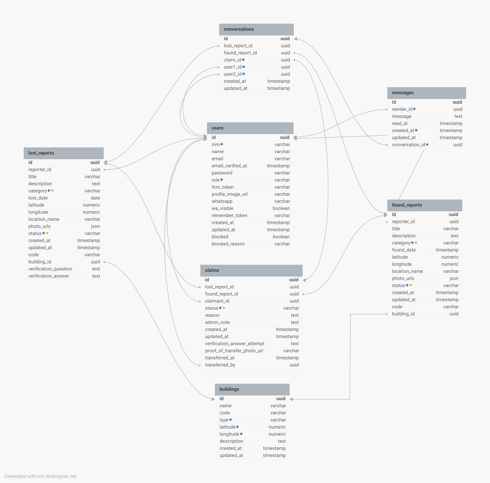

# ERD Lost & Found

> [!warning] Gambar mungkin belum diperbarui
> Gambar ERD mungkin belum mencerminkan 7 tabel dan skema SSO terbaru; deskripsi teks di bawah yang berlaku sampai gambar diperbarui.

## Deskripsi Tabel & Relasi

### Tabel Utama

#### 1. `users`

Menyimpan pengguna aplikasi (mahasiswa, dosen, karyawan) dan admin. NIM opsional + unique; dapat diekstrak otomatis dari email mahasiswa bila pola cocok. Login user memakai Google SSO pada tiga domain Polines.

- **PK:** `id` (UUID)
- **Kolom identitas:** nim (unique, nullable), name, email (unique; tiga domain Polines), email_verified_at, password (nullable untuk user SSO), remember_token
- **Kolom profil & kontak:** whatsapp, wa_visible (default `false`, mengatur apakah nomor WA ditampilkan ke pengguna lain), profile_image_url, fcm_token (untuk push notification)
- **Kolom akses:** role (`user | admin`, default `user`), blocked (default `false`), blocked_reason
- **Index:** nim, role
- **Relasi:** 1 user → N lost_reports, N found_reports, N claims (sebagai pengklaim), N messages, N conversations (sebagai `user1` atau `user2`). Pada `claims`, user juga dapat berperan sebagai `transferred_by`.

#### 2. `buildings`

Master data gedung/lokasi kampus untuk fitur pilih lokasi di peta dan saran gedung terdekat (Haversine lokal di Flutter).

- **PK:** `id` (UUID)
- **Kolom:** name, code, type (default `gedung`), latitude, longitude, description
- **Index:** type, composite `(latitude, longitude)` untuk query koordinat
- **Relasi:** 1 building → N lost_reports, N found_reports

#### 3. `lost_reports`

Laporan barang hilang yang dibuat pengguna.

- **PK:** `id` (UUID)
- **FK:** `reporter_id` → users.id, `building_id` → buildings.id (nullable)
- **Kolom:** code (unique, kode laporan yang mudah dibaca), title, description, category, lost_date (date), latitude, longitude (titik yang dipilih user di peta), location_name (aturan: gedung+detail → "Nama Gedung, detail"; gedung saja → "Nama Gedung"; tanpa gedung+detail → detail; tanpa gedung+detail kosong → "Titik di peta (area luar gedung)"), photo_urls (JSON, **path relatif** mis. `reports/uuid.jpg`; URL lengkap dibangun di response dari `APP_URL`), status (default `pending`)
- **Check constraint:**
    - category ∈ `buku`, `elektronik`, `jaket_kemeja`, `dompet`, `aksesoris`, `alat_tulis`, `lainnya`
    - status ∈ `pending`, `claimed`, `returned`, `closed`
- **Index:** category, status
- **Relasi:** 1 lost_report → N claims, N conversations

#### 4. `found_reports`

Laporan barang temuan.

- **PK:** `id` (UUID)
- **FK:** `reporter_id` → users.id, `building_id` → buildings.id (nullable)
- **Kolom:** code (unique), title, description, category, found_date (timestamp, mencatat jam penemuan), latitude, longitude (titik yang dipilih user di peta), location_name (aturan sama dengan lost_reports), photo_urls (JSON, **path relatif** mis. `reports/uuid.jpg`; URL lengkap dibangun di response dari `APP_URL`), status (default `pending`)
- **Check constraint:**
    - category sama dengan `lost_reports`
    - status ∈ `pending`, `claimed`, `returned`, `closed`
- **Index:** category, status
- **Relasi:** 1 found_report → N claims, N conversations

#### 5. `claims`

> [!note] Kolom baru disetujui 2026-10-14
> Tiga kolom baru disetujui user: `accepted_at`, `closed_reason`, `closed_by`. Belum ada migration. Lihat [[Claim Dua Arah dan Serah Terima oleh Pengguna - Lost&Found]].

Pengajuan klaim yang menghubungkan laporan hilang, laporan temuan, dan pengklaim.

- **PK:** `id` (UUID)
- **FK:** `lost_report_id` → lost_reports.id (NOT NULL), `found_report_id` → found_reports.id (NOT NULL), `claimant_id` → users.id, `transferred_by` → users.id (nullable), `closed_by` → users.id (nullable, kolom baru)
- **Kolom klaim:** status (default `pending`), reason (text), admin_note (text), `accepted_at` (timestamp nullable, kolom baru), `closed_reason` (text nullable, kolom baru)
- **Kolom serah terima:** proof_of_transfer_photo_url (**path relatif** mis. `claims/proof/uuid.jpg`; URL dibangun di response dari `APP_URL`), transferred_at, transferred_by
- **Check constraint:** status ∈ `pending`, `accepted`, `returned`, `rejected`, `withdrawn`
- **Index:** status, `accepted_at` (kolom baru, untuk query expire)
- **Relasi:** Many-to-one ke lost_reports, found_reports, users; 1 claim → N conversations (chat otomatis dibuat saat claim)

#### 6. `conversations`

Ruang percakapan antara dua pengguna, biasanya terkait klaim atau laporan tertentu.

- **PK:** `id` (UUID)
- **FK:** `user1_id` → users.id, `user2_id` → users.id, `lost_report_id` → lost_reports.id (nullable), `found_report_id` → found_reports.id (nullable), `claim_id` → claims.id (nullable)
- **Index:** claim_id, user1_id, user2_id
- **Relasi:** 1 conversation → N messages

#### 7. `messages`

Pesan individual di dalam percakapan (fitur real-time chat).

- **PK:** `id` (UUID)
- **FK:** `conversation_id` → conversations.id, `sender_id` → users.id
- **Kolom:** message (text), read_at (null berarti belum dibaca)
- **Index:** conversation_id, created_at, sender_id

## Ringkasan Relasi

|Dari|Ke|Jenis|Keterangan|
|---|---|---|---|
|users|lost_reports / found_reports|1 : N|pelapor (`reporter_id`)|
|users|claims|1 : N|pengklaim (`claimant_id`) dan pemroses serah terima (`transferred_by`)|
|buildings|lost_reports / found_reports|1 : N|lokasi gedung (opsional)|
|lost_reports|claims|1 : N|satu laporan dapat diklaim beberapa kali|
|found_reports|claims|1 : N|satu temuan dapat memiliki beberapa klaim|
|claims|conversations|1 : N|chat yang terkait klaim (opsional)|
|users|conversations|1 : N (×2)|`user1_id` dan `user2_id`|
|conversations|messages|1 : N|isi percakapan|
|users|messages|1 : N|pengirim pesan|

## Alur Status

> [!warning] Arti `accepted` akan berubah
> Di [[Claim Dua Arah dan Serah Terima oleh Pengguna - Lost&Found]], arti status `accepted` berubah dari "admin menerima claim" menjadi "penerima claim (pihak yang tidak mengajukan) menekan Cocok/Ya". Admin tetap bisa override.

**Lost Report:** pending → claimed → returned / closed

**Found Report:** pending → claimed → returned / closed

**Claim:** pending → accepted → returned / rejected / withdrawn

**Keterangan:**
- Claim `accepted` = admin setujui, laporan lost & found jadi `claimed` (akan berubah: penerima yang setujui)
- Claim `returned` = barang diserahkan (via markTransferred), laporan lost & found jadi `returned`
- Claim `withdrawn` = pengaju batalkan atau kedaluwarsa 7 hari

## Constraint & Index

- Semua nilai `status` dan `category` dibatasi dengan **check constraint** dan disimpan dalam huruf kecil.
- **Unique constraint:** users.nim, users.email, lost_reports.code, found_reports.code
- **Index** untuk pencarian dan filter: category, status, role, nim, type, koordinat `(latitude, longitude)` pada `buildings`, serta kolom FK pada `conversations` dan `messages`.

## Perubahan dari Versi ERD Sebelumnya

- **2026-10-05:** Status "matched" dihapus dari `found_reports`. Alur status baru: pending → claimed → returned / closed. Check constraint diperbarui. Status `returned` ditambahkan ke `claims` enum. Alur claim: pending → accepted (admin setujui) → returned (barang diserahkan via markTransferred).
- Tiga tabel baru: `buildings`, `conversations`, `messages`.
- Tabel `matching_recommendations` (opsional) tidak lagi ada.
- Kolom baru: `code`, `building_id` pada laporan; `wa_visible`, `blocked`, `blocked_reason` pada `users`; kolom bukti transfer pada `claims`.
- `found_date` kini bertipe timestamp, sedangkan `lost_date` tetap date.
- Nilai status ditulis huruf kecil, dan `claims` memiliki FK tambahan `transferred_by`.
- **2026-10-02:** Kolom verifikasi kepemilikan (`verification_question`, `verification_answer` di `lost_reports`, dan `verification_answer_attempt` di `claims`) dihapus. Verifikasi kepemilikan kini dilakukan via real-time chat, bukan pertanyaan keamanan.
- **2026-10-08:** Autentikasi email mahasiswa, NIM wajib, role student (riwayat; diganti pada 2026-10-10).
- **2026-10-10:** Google SSO diterapkan untuk tiga domain Polines; role `user | admin` default `user`; password nullable untuk pengguna SSO; NIM opsional, unik, otomatis dari email mahasiswa bila pola cocok. Implementasi dan migration selesai menurut laporan user; login mahasiswa diuji di HP fisik.
- **2026-10-11:** Flow lokasi diubah. User memilih lokasi dengan menaruh pin di peta (`flutter_map` + OpenStreetMap), bukan GPS otomatis. Koordinat laporan = titik yang dipilih user; gedung (jika dipilih) hanya mengisi `building_id` dan `location_name`, tidak menimpa koordinat. Aturan lama "gedung menang atas GPS" dibalik. Aturan `location_name` baru: gedung+detail → "Nama Gedung, detail"; gedung saja → "Nama Gedung"; tanpa gedung+detail → detail; tanpa gedung+detail kosong → "Titik di peta (area luar gedung)". Endpoint `POST /location/suggest` dan `LocationService` backend dicoret; Haversine dihitung lokal di Flutter (opsi B). `building_id` tetap nullable; backend tetap memvalidasi building_id (uuid, exists) dan menolak koordinat kosong/0,0.
- **2026-10-14:** Tiga kolom baru di `claims` disetujui: `accepted_at` (timestamp, untuk hitung kedaluwarsa 7 hari), `closed_reason` (text, alasan rejected/withdrawn/expired), `closed_by` (uuid FK users, null = sistem). Belum ada migration. Lihat [[Claim Dua Arah dan Serah Terima oleh Pengguna - Lost&Found]]. Chat read-only dihitung dari kondisi claim atau laporan, bukan dari kolom tersimpan.
- **2026-10-14 (lanjutan):** `photo_urls` (lost_reports & found_reports) dan `proof_of_transfer_photo_url` (claims) kini menyimpan **path relatif** (mis. `reports/uuid.jpg`, `claims/proof/uuid.jpg`); URL lengkap dibangun di response API dari `APP_URL`. Struktur kolom **tidak berubah** (Backlog Item 4, selesai 2026-10-14).